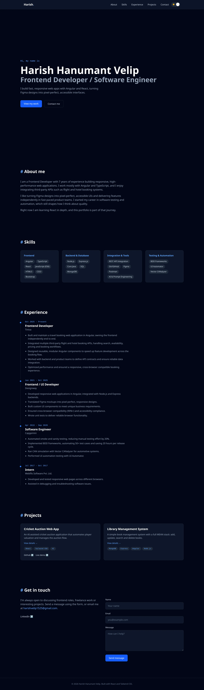

# Harish Hanumant Velip | Portfolio

[](https://github.com/harishvelip28/my_portfolio/actions/workflows/ci.yml)

A responsive, accessible portfolio site built with React and TypeScript. I started it to learn React coming from an Angular background, and it grew into a project covering routing, testing, CI and accessibility.

**Live site:** https://my-portfolio-ruby-psi-83.vercel.app



## Features

- Light and dark theme, following the system setting and remembering the visitor's choice
- Project detail pages at `/projects/:slug`, lazy-loaded, with per-page titles
- Active navigation highlighting using `IntersectionObserver`
- Scroll-reveal animations that respect the "reduce motion" setting
- Contact form that sends messages through Formspree
- Latest public repositories loaded from the GitHub API
- Accessible: skip link, visible focus styles, keyboard-friendly menu, automated axe checks

## Lighthouse (deployed site)

| Performance | Accessibility | Best practices | SEO |
|---|---|---|---|
| 100 | 96 | 100 | 54 |

## Tech stack

React, TypeScript (strict), Vite, Tailwind CSS, React Router, Vitest, React Testing Library, axe-core, ESLint, GitHub Actions, Vercel.

## Getting started

```bash
git clone https://github.com/harishvelip28/portfolio.git
cd portfolio
npm install
npm run dev
```

| Script | What it does |
|---|---|
| `npm run dev` | Start the dev server |
| `npm run build` | Type-check and build for production |
| `npm run preview` | Serve the production build locally |
| `npm run lint` | Run ESLint |
| `npm run typecheck` | Run the TypeScript compiler without emitting files |
| `npm run test` | Run tests in watch mode |
| `npm run test:coverage` | Run tests once with a coverage report |

## Project structure

```
src/
├── components/   UI sections and shared pieces
├── data/         typed content: profile, skills, experience, projects
├── hooks/        useTheme, useActiveSection, useInView, useGithubRepos, useDocumentTitle
├── pages/        Home, ProjectDetail, NotFound, ErrorPage
├── test/         test setup
├── routes.tsx    route table
├── router.tsx    browser router
└── types.ts      shared TypeScript types
```

## Design decisions

- **Content is separate from layout.** Jobs, skills and projects live in typed files under `src/data`, so updating them never touches a component.
- **Colours are semantic tokens** (CSS variables such as `text-muted`), which is how the theme switch works without per-component overrides.
- **Tests at three levels:** components, hooks, and the real route table rendered with an in-memory router, plus an accessibility scan.
- **CI** runs lint, type checks, tests with coverage and the production build on every push to `main` and on pull requests.

## Customising

Edit the files in `src/data` and, for the contact form, the endpoint in `src/data/profile.ts`. No environment variables are needed.

## Deployment

Deployed on Vercel. `vercel.json` rewrites every route to `index.html` so direct links to project pages work.